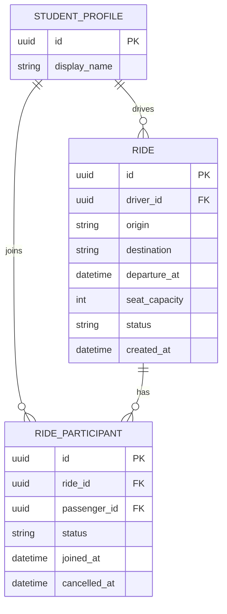

# Gestão de Caronas na UTFPR

Plataforma web para conectar estudantes da UTFPR que oferecem e procuram
caronas, organizando trajetos, horários e vagas disponíveis.

## Autores

- A preencher pela equipe.

## Documentação

- [PRD](docs/prd.md)
- [Arquitetura](docs/architecture.md)
- [Tokens de design](docs/design-tokens.md)
- [Checklist da disciplina](docs/checklist.md)
- [Protótipo no Stitch](https://stitch.google.com/projects/328477196056609722)

## Modelagem de dados



## Stack

- Angular 22+ e Tailwind CSS
- json-server no MVP/E2; Supabase Auth e Postgres com RLS na E3
- Vitest, angular-eslint e Prettier

## Executar localmente

Requer Node.js compatível com Angular 22 e npm.

```bash
npm install
```

Em terminais separados, inicie a API local e a aplicação:

```bash
npm run api
npm start
```

A aplicação fica disponível em `http://localhost:4200`; a API json-server usa
`http://localhost:3000`.

## Verificação e formatação

```bash
npm test
npm run lint
npm run format:check
```

Para aplicar a formatação, execute `npm run format`. O comando `npm run build`
gera a versão de produção.

## Produção

O deploy está previsto para a Vercel, associado à branch `main`; a URL será
definida pela equipe.
