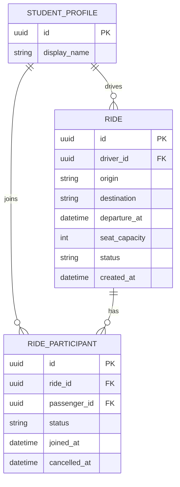

# 🛠️ Architecture / SSD

**Projeto:** Gestão de Caronas na UTFPR
**Versão:** 1.0.0 · arquitetura inicial
**Última atualização:** Outubro de 2026

> 🤖 **O `prd.md` responde _o quê_ o produto faz. Este responde _onde as coisas
> moram e como se chamam_.** Detalhe de tela — rota, componente, contrato —
> **não** se decide aqui: isso é trabalho da spec de cada história.
> (No texto oficial da disciplina este documento é o `ssd.md` — ID31.)
>
> ✍️ Este documento foi produzido pela entrevista `/utf-architecture`, depois
> do PRD e do Design System. O `/utf-setup` deve seguir as decisões registradas
> aqui, sem acrescentar dependências ou substituir padrões.

---

## 🤖 1. Fontes de Contexto para a IA

> Onde a IDE agêntica busca a verdade. **Isto é o índice; a configuração mora
> nos arquivos** — documento não configura ferramenta.

| Fonte | Onde configurar | Serve para |
| :---- | :-------------- | :--------- |
| Constituição da IA | `.agents/rules/utf-rules.md` (via `CLAUDE.md`) | Regras inegociáveis: fases do SDD, 2 rodadas, revisores distintos, Gitflow |
| Fluxos da IA | `.agents/workflows/` | PRD, backlog, design, architecture, setup, ciclo por Issue, ciclo por tarefa, tutor |
| Agentes (subagentes) | `.agents/agents/` (cascas em `.claude/`, `.cursor/`, `.opencode/`) | Implementador, revisores, auditor final e tutor |
| Ficha da disciplina | `docs/checklist.md` | Regras do projeto, IDs e entregas |
| Protótipo (Stitch/Figma) | [Protótipo público no Stitch](https://stitch.google.com/projects/328477196056609722) | Telas, jornadas e hierarquia visual (ID1) |
| MCPs e Skills da IDE | Figma, Supabase (E3), Context7 e Skill compatível com Angular 22+ | Contexto do protótipo, BaaS e documentação atual (ID32) |

---

## 📦 2. Stack Tecnológica

> Definição **estrita**: nenhuma dependência entra sem aparecer aqui. Esta
> seção e o `package.json` contam a mesma história, ou o projeto já se perdeu.
> O que a ficha fixa entra como está; o que ela deixa livre é decidido na
> entrevista.

- **Frontend:** Angular 22+ com Angular CLI compatível com essa linha. O
  documento registra a linha, não uma versão de patch.
- **Padrões Angular:** componentes standalone (sem `standalone: true`), Signals
  para estado, `@if`/`@for`/`@switch`, `@for` sempre com `track`, `@defer`,
  `input()`/`output()`/`model()`, `inject()`, Pipes e lazy loading por feature.
  Usar `effect()` somente para efeitos colaterais, não para derivar estado.
- **Framework CSS:** Tailwind CSS (ID5), com os tokens de
  [`docs/design-tokens.md`](./design-tokens.md).
- **Dados:** json-server no MVP/E2 e Supabase (Postgres, Supabase Auth e RLS)
  na E3. A substituição do provedor de dados fica restrita aos Services (§2.1).
- **PWA:** `manifest.webmanifest`, ícones, cores, splash, `standalone` e suporte
  offline (ID3); Angular Service Worker para assets e IndexedDB para a última
  lista de caronas, usando a API nativa do navegador (sem dependência adicional).
- **Autenticação E3:** `@supabase/supabase-js` somente para cadastro, login e
  ciclo de sessão. O CRUD de dados usa a API REST do Supabase por Angular
  `HttpClient`.
- **Testes:** Vitest, conforme o gerador oficial do Angular CLI da linha 22.
  O comando da suíte, sem watch, é `npm test` na raiz.
- **Lint e formatação:** `angular-eslint` integrado ao CLI e Prettier com
  `eslint-config-prettier` na raiz. O comando de lint é `npm run lint` na raiz.
  `npm run format` aplica Prettier; `npm run format:check` verifica a formatação.
- **Comandos do monorepo:** `npm install`, `npm run start`, `npm run api`,
  `npm test` e `npm run lint`, executados na raiz do repositório.

### 🌐 2.1. Camada de dados — regras estruturais

> Declaradas uma a uma na entrevista, percorrendo os IDs da ficha.

- **Componente não fala com o servidor:** todo acesso de rede passa por Services
  injetados com `inject()`. As telas dependem de modelos tipados, não de
  `HttpClient`, URLs ou formatos particulares do provedor. A migração E3 troca
  apenas a implementação dos Services.
- **MVP/E2:** json-server usa o `db.json` da raiz. A autenticação é uma
  simulação em memória para demonstrar o fluxo; não persiste senhas nem oferece
  segurança real. A sessão simulada se perde ao recarregar a aplicação.
- **Supabase Auth/E3:** `AuthService` encapsula o SDK oficial para cadastro,
  login, sessão e renovação dos tokens. Nenhuma tela usa o SDK diretamente.
- **CRUD Supabase/E3:** Services usam Angular `HttpClient` contra a API REST.
  Interceptors funcionais adicionam o JWT somente às chamadas autenticadas do
  Supabase e normalizam falhas HTTP para `ApiError` (`status`, `code` e
  `message`). Os Services preservam os tipos dos recursos e propagam falhas; a
  interface decide como apresentar cada erro em português.
- **Integração pública (ID20):** requisições GET também ficam em Services e
  usam `HttpClient`; a API concreta é escolhida na spec da história que precisar
  dela.
- **Validação (ID24 / RNF05):** formulários Reativos validam no cliente,
  apresentam mensagens claras e desabilitam o submit quando inválido. O
  json-server do MVP não executa validação de domínio no servidor; essa
  limitação é explícita e aceita para E2. Na E3, constraints do Postgres e RLS
  reforçam validação e autorização no servidor.
- **Assíncrono ↔ reativo (ID25):** `toSignal()` e `toObservable()` são usados
  na fronteira entre Observables de `HttpClient`/RxJS e Signals.

---

## 🗂️ 3. Estrutura do Projeto

```text
.
├── .agents/               # constituição, workflows e prompts dos agentes (§1)
├── CLAUDE.md / AGENTS.md  # cascas por ferramenta (.claude/, .cursor/, .opencode/)
├── README.md              # a vitrine, na estrutura exigida pela ficha
├── docs/                  # prd.md, este arquivo, design-tokens.md, checklist.md e guias
├── specs/                 # uma pasta por história implementada
├── package.json           # a raiz do workspace: scripts de orquestração (§3.1)
├── db.json                # dados locais do json-server (MVP/E2)
└── apps/
    ├── web/               # o app Angular — package.json próprio
    └── api/               # apenas README; reservada para uma API futura
```

> 📌 **Por que `apps/` com duas pastas se só uma tem código.** Nesta disciplina os
> dados vêm do json-server e depois do BaaS: não há backend para escrever. A pasta
> `apps/api/` não contém código executável nem `package.json`; o README existente
> apenas documenta sua reserva para uma API futura. O `/utf-setup` não gera backend.
> O `db.json` do json-server fica na raiz do monorepo.

### 📦 3.1. A raiz do monorepo (npm workspaces)

O `package.json` da raiz declara os subprojetos e concentra os comandos:

```json
{
  "name": "[nome-do-projeto]",
  "private": true,
  "workspaces": ["apps/*"],
  "scripts": {
    "start": "npm run start -w apps/web",
    "build": "npm run build -w apps/web",
    "test":  "npm run test -w apps/web -- --no-watch",
    "lint":  "npm run lint -w apps/web",
    "format": "prettier --write .",
    "format:check": "prettier --check .",
    "api":   "json-server db.json"
  }
}
```

> 📌 **O que os workspaces resolvem aqui.** Um `npm install` na raiz instala as
> dependências de todos os `apps/*` de uma vez, num `node_modules` só: quem clona o
> repositório roda **um** comando, não um por pasta. A flag `-w` executa um script
> dentro de um subprojeto sem `cd`. O curinga `apps/*` faz qualquer pasta nova ali
> dentro ser reconhecida sem editar este arquivo, e `"private": true` impede a
> publicação acidental no npm. **`apps/api/` não tem `package.json` e é ignorada pelo
> npm.** `npm test` delega a `ng test --no-watch` no app web; `npm run lint` delega
> a `ng lint`.

### Organização interna do app (`apps/web/src/app/` — feature-driven)

- `core/`: Services de dados/autenticação, guards e interceptors singleton.
- `shared/`: componentes reutilizáveis sem regra de domínio e Pipes.
- `features/<domínio>/`: páginas e componentes de cada domínio, carregados sob
  demanda por rota.

As features podem depender de `core/` e `shared/`, mas não umas das outras.
`core/` e `shared/` não dependem de features; `shared/` também não depende de
`core/`. Comunicação entre domínios passa por contratos públicos em `core/` ou
por navegação, sem import direto de uma feature por outra.

---

## 🧭 4. Roteamento e Navegação

> A ficha cobra a API funcional moderna (IDs 16–19): `provideRouter` com
> `withComponentInputBinding()`, parâmetros de rota via Signal `input()`,
> rotas filhas para hierarquia de layout, Functional Guards e Resolvers.

Configurar `provideRouter()` e `withComponentInputBinding()`. Usar Signal
`input()` para parâmetros de rota, rotas filhas para layouts hierárquicos,
Functional Route Guards para controle de acesso e Resolvers para pré-carregar
dados (IDs 16–19). Cada feature define suas rotas na própria spec; o mapa do §6
é atualizado quando uma história é implementada.

---

## ✅ 4.1. Requisitos estruturais da ficha (IDs)

| IDs | Padrão arquitetural |
| :-- | :-- |
| 1–3 | Protótipo público e tokens em `docs/design-tokens.md`; Mobile-First; PWA com manifest, ícones, cores, splash, `standalone`, offline via Service Worker e cache de dados em IndexedDB. |
| 4–9 | Standalone; Tailwind; `@if`/`@switch`; `@for` com `track`; Pipes; `@defer` para conteúdo pesado sob demanda. |
| 10–15 | One-way binding; Signals writable/computed como estado; event binding; `model()`; `effect()` para efeitos colaterais; `input()`/`output()`; Services e `inject()`. |
| 16–19 | `provideRouter`, `withComponentInputBinding()`, parâmetros via Signal `input()`, rotas filhas, Functional Guards e Resolvers. |
| 20–25 | GET público via Service; Supabase Auth/JWT; CRUD via REST e `HttpClient`; Functional Interceptors; Reactive Forms; `toSignal()`/`toObservable()`. |
| 26–28 | Gitflow `main`/`develop`, trabalho em branches curtas e PRs para `develop`; deploy automatizado na Vercel a partir da `main`. |
| 29–33 | User Stories/Issues e Kanban via SDD; PRD e esta arquitetura como fontes técnicas; MCPs/Skills para contexto; testes unitários Vitest escritos em TDD antes do código de produção. |

---

## 🗄️ 5. Arquitetura de Dados (BaaS)

### 📖 5.1. Glossário Técnico (Mapeamento)

> A ponte entre o português do negócio (PRD §2) e o inglês do código.
> **Dados e código em inglês, interface em português.**

| Termo PRD (PT-BR) | Entidade/Tabela (EN) | Atributos principais |
| :---------------- | :------------------- | :------------------- |
| Estudante | `profiles` / `StudentProfile` | `id`, `display_name`; na E3 o `id` referencia `auth.users.id`. E-mail e credenciais pertencem ao Supabase Auth. |
| Responsável pela carona | `profiles` / `StudentProfile` | Mesmo estudante que criou a carona; relacionado por `rides.driver_id`. |
| Carona | `rides` / `Ride` | `id`, `driver_id`, `origin`, `destination`, `departure_at`, `seat_capacity`, `status`, `created_at`. |
| Passageiro / participação | `ride_participants` / `RideParticipant` | `id`, `ride_id`, `passenger_id`, `status`, `joined_at`, `cancelled_at`. Um registro por tentativa preserva o histórico; só pode existir uma participação `active` por par carona/passageiro. |
| Vaga disponível | Derivada de `Ride` e `RideParticipant` | `seat_capacity` menos a contagem de participações `active`; não é armazenada como contador independente. |
| Origem / destino | `rides` / `Ride` | `origin`, `destination`. |
| Data / horário | `rides` / `Ride` | Um único `departure_at` com data e hora. |
| Carona disponível | `rides` / `Ride` | `status = active` e pelo menos uma vaga derivada disponível. |
| Solicitação | `ride_participants` / `RideParticipant` | Solicitar cria um registro `active`; cancelar marca `cancelled` e preenche `cancelled_at`, sem apagar o histórico. Uma nova solicitação cria outro registro. |

### 📊 5.2. Diagrama ER (Mermaid)

> As tabelas do BaaS e seus relacionamentos — o mesmo diagrama vai renderizado
> no README, como a ficha exige.



No json-server, `db.json` tem as coleções `profiles`, `rides` e
`ride_participants`, com os campos em inglês acima. Na E3, as tabelas
correspondentes ficam no schema público do Supabase; `profiles.id` referencia
`auth.users.id`. Campos persistidos usam `snake_case`; os modelos de aplicação
permanecem tipados, e qualquer adaptação do formato fica no Service.

O formato-base do arquivo do MVP é:

```json
{
  "profiles": [],
  "rides": [],
  "ride_participants": []
}
```

Em `ride_participants`, cada tentativa é um registro. Uma restrição única
parcial em `(ride_id, passenger_id)` para linhas `status = 'active'` impede
participação duplicada sem apagar registros cancelados. O status de `rides` usa
`active`, `cancelled` ou `completed`; o de participação usa `active` ou
`cancelled`.

Quando estiver offline, a interface exibe a faixa persistente definida nos
tokens, apresenta a última lista armazenada em IndexedDB e desabilita ações que
dependem do servidor com uma explicação. Ao reconectar, atualiza os dados e
remove a faixa.

### 🔒 5.3. Segredos e ambientes

> URL e anon/publishable key do Supabase podem estar no `environment.ts` do
> frontend, pois são públicas por definição. A proteção dos dados depende de RLS
> habilitada nas tabelas públicas e de políticas que limitem operações ao
> usuário autenticado e aos registros permitidos. **Service role keys, tokens de
> serviço e outros segredos nunca entram no frontend nem no repositório.**

| Fase | App roda em | Dados |
| :--- | :--- | :--- |
| **Local (E2/MVP)** | `ng serve` + json-server via `npm run api` | `db.json` local na raiz; autenticação simulada em memória, sem credenciais persistidas |
| **Local (E3)** | `ng serve` | Supabase de desenvolvimento; Supabase Auth e Postgres com RLS |
| **Produção (E3)** | Vercel; deploy de produção associado à `main` | Supabase de produção; segredos administrativos somente fora do frontend |

---

## 🗺️ 6. Mapa de Domínios e Rotas

> **Este índice cresce.** Não é para preencher agora: **uma linha por história
> implementada** — a spec é que define rota e contrato. Aqui fica só o mapa de
> quem já existe.

| Domínio | Rota | Guard | Dados (service) | US |
| :------ | :--- | :---- | :-------------- | :-- |
| | | | | |

---

## 📅 7. Histórico

| Data | Versão | O que mudou |
| :--- | :----- | :---------- |
| 18/10/2026 | 1.0.0 | Arquitetura inicial definida a partir do PRD, Design System e ficha da disciplina |

---

## 🛑 O que ainda **não** está neste documento

Detalhes de funcionalidade — contratos de uma tela específica, máquinas de
estado de uma história — **não entram aqui**: nascem sob demanda no `spec.md`
de cada história. Este documento guarda só o que vale para o sistema inteiro.
